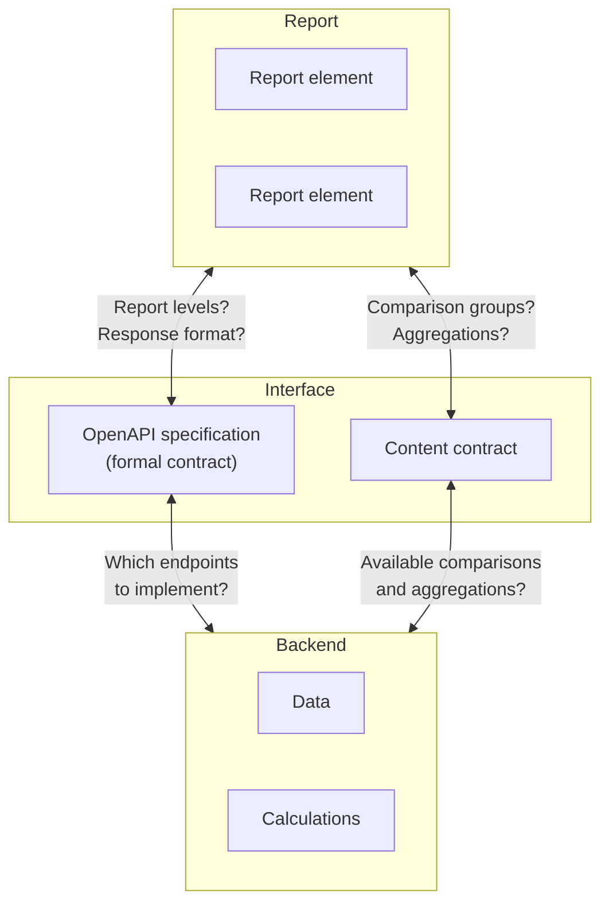

<!-- Übersetzung von konzepte.md, sha256:d389ae78594d706da5829d6ecff282ff38d7d5ce09d0c4dd255139e303b127ca -->

# TBA3 evaluation interface: concepts and architecture

The TBA3 evaluation interface defines a common data format
through which report elements (UI components) can be exchanged between different project partners
without having to be redeveloped for every backend.

---

## Goal: interchangeable report elements

"Interchangeable" means: a report element works with the data of other TBA3-compliant backends.
Ideally regardless of which partner developed the backend, in which state it is used,
or how the underlying calculations work internally.

Ideally, a report element knows only the TBA3 OpenAPI specification. It receives data in a defined format and displays it.
The remaining questions - which context? which comparison values? which aggregation? - are controlled by the calling report, which passes this information into the report element.

---

## Role of the specification



| Layer                    | Knows                                                                                                         | Responsible for...                                                                                                                       |
|--------------------------|---------------------------------------------------------------------------------------------------------------|------------------------------------------------------------------------------------------------------------------------------------------|
| **Report**               | logged-in user, master data, capabilities of the backend                                                      | assembling the right requests or passing context information to report elements; needs information about BOTH contracts                 |
| **Report element**       | OpenAPI spec (response format, data types)                                                                    | receiving and displaying data/context information; ideally needs only the OpenAPI specification                                         |
| **OpenAPI spec**         | endpoints, response format, data types                                                                        | specifying a uniform data format that serves as the common basis for all backends and frontends                                         |
| **Content contract**     | backend capabilities, frontend presentations, e.g. for comparison groups, aggregations, query param formats   | giving substance to the open points of the interface                                                                                     |
| **Backend**              | own data, own calculations                                                                                    | implementing endpoints, processing parameters, performing calculations, delivering spec-compliant responses                             |

**OpenAPI specification (formal contract):** Governs the *structure* of the interface: which endpoints exist,
which fields a response has, and which data types they have.
In theory, a report element only needs to know this contract to work with any TBA3-compliant backend.

**Content contract:** Governs the *semantics* of the questions the specification leaves open:
which comparison groups the backend can offer, which kinds of aggregation are supported, and how the parameter values for them must be formatted.
This contract is system-specific and is not covered by the OpenAPI spec. The report must know it to assemble the right requests.

This two-part structure raises the question of how far the content contract can be standardized and what that means for flexibility and interchangeability.

---

## What the specification covers

### Shared endpoints

The spec defines a 3×3 matrix of report levels and result data:

| | Competence levels | Items | Aggregations |
|---|---|---|---|
| **Learning group** | `GET /groups/{id}/competence-levels` | `GET /groups/{id}/items` | `GET /groups/{id}/aggregations` |
| **School** | `GET /schools/{id}/competence-levels` | `GET /schools/{id}/items` | `GET /schools/{id}/aggregations` |
| **State** | `GET /states/{id}/competence-levels` | `GET /states/{id}/items` | `GET /states/{id}/aggregations` |

Each combination is a separate endpoint. All of them return the same basic format: an array of value groups.

### Shared data format: the value group

The value group is the universal container of the spec. All endpoints return arrays of value groups. What a single value group represents depends on the context:

- A learning group (e.g. "Klasse 8a")
- An individual student (e.g. "Schüler 1")
- A school or a state
- A comparison value (e.g. "Korrigierter Landesmittelwert", an adjusted state average)
- A subgroup by covariate (e.g. "girls in class 8a")

Every value group has the same basic structure:

```
Value-Group
├── id           (optional) — unique identifier
├── name         (required) — label, e.g. "Klasse 8a"
├── domain       (optional)
│   ├── id       (optional)
│   └── name     (required) — e.g. "Leseverstehen"
├── subject      (optional)
│   ├── id       (optional)
│   └── name     (required) — e.g. "Deutsch"
├── covariates   (optional) — covariates of the value group (gender, language, ...)
├── properties   (optional) — free key-value metadata
│
└── ... result data (depending on the endpoint)
    ├── competenceLevels[]   ← for /competence-levels
    ├── items[]              ← for /items
    └── aggregations[]       ← for /aggregations
```

The result data in the lower part of the value group is endpoint-specific — a value group always contains exactly one of these three types.
Covariates and properties are extension points through which system-specific context data can be transported.

---

## What the spec deliberately leaves out

- **Master data**: which classes, schools or learning groups exist; which test booklet compositions are available
- **Authentication**: how a frontend authenticates with the backend

---

## Openness vs. standardization

The tension between the two parts of the interface shows above all in the **content contract**:
the query parameters `type`, `comparison`, `aggregation` and `domain` are defined as free strings.
For `type`, for example, there are already examples in the specification and the mock server (`students`, `group,students`, `state,district`), but no fixed enum.
A report+backend pair can introduce its own values. For `comparison`, `aggregation` and `domain` there are no requirements either.
`properties` are also freely extensible, and covariates allow `other` types.

This openness gives every backend maximum flexibility in its implementation.
At the same time it means: **the less is standardized, the harder exchanging report elements between partners can become.**
What `comparison=8a` actually returns is decided by the backend.
Without shared conventions, the report must know the content capabilities of each backend individually, and a report element may have to
format query parameters differently or be adapted for missing/different/additional properties.

This tension between flexibility and interoperability gives rise to different levels of cooperation.

---

## Levels of defining and interpreting the specification

|                             | Level 1: OpenAPI spec compliant                                             | Level 2: spec + conventions                                                                                       | Level 3: fully specified                                                            |
|-----------------------------|-----------------------------------------------------------------------------|-------------------------------------------------------------------------------------------------------------------|-------------------------------------------------------------------------------------|
| **What is standardized?**   | Endpoints, response format, data types                                      | + documented conventions for `comparison`, `aggregation`, `type`, `domain` (possibly `covariates`, `properties`)  | Finite list of all report elements, spec covers every use case                      |
| **What is interchangeable?** | Simple/general report elements, e.g. a competence level distribution       | + more complex elements (e.g. competence level distribution with comparison groups)                               | All report elements fully interchangeable                                           |
| **Implementation effort**   | Low: basic data is calculated anyway                                        | Medium: query param parsing, more calculation combinations                                                        | Exploding: all report elements × all optional combinations × all backends           |
| **Flexibility**             | Maximum: everyone implements only their own use cases                      | High: own extensions remain possible                                                                              | Low: every change affects all partners                                              |

### Level 1: OpenAPI spec compliant

The minimum requirement: a backend implements the endpoints defined in the OpenAPI spec and delivers responses in the prescribed format.
Simple report elements (e.g. a competence level distribution for a single class) should be interchangeable right away.

**Limitation:** More complex report elements that depend on comparison groups or aggregations, or that use unspecified properties for display,
may need adjustments when used with another backend, because there are no shared conventions for the corresponding parts.

### Level 2: OpenAPI spec + conventions (recommended)

Building on level 1, we document conventions in the project for known use cases of query parameters and open response components:
which values are used for `comparison`, `aggregation`, `type` and `domain` and what they mean,
and which covariates and properties may exist and what each of them means.
Backends return `501 Not Implemented` for conventions they do not support.

This makes more complex report elements more interchangeable as well, e.g. a competence level distribution with comparison groups.
The additional effort falls mainly on the backend side (query parameters must be parsed, additional calculation combinations supported).
Own extensions remain possible at any time.

**The way from level 1 to level 2 is short:** often it is enough to agree on conventions for the query parameters, without changing the spec itself.

### Level 3 as a boundary: fully specified

The spec defines a finite, closed list of all report elements and covers every use case. Maximum interoperability — every frontend works with every backend without prior agreement.

**The price:** exploding effort. All frontends must be able to handle every optional parameter combination. All backends must implement all use cases of all partners — including those irrelevant to their own system. With 4 frontends × n backends, this approach does not scale.

This level is **deliberately not** the goal of the project.

---

## Influence of report elements on interoperability

The level model describes the backend side. On the frontend side, an analogous question arises:
how much semantics does a report element build in? The more it does, the more specific it becomes and the tighter its coupling to the content contract.
Depending on the degree of coupling, there are three variants:

### Variant A: data-driven

The element is handed finished, spec-compliant data (value groups).
It knows only the response format (OpenAPI spec), not the backend.
Optional fields and `properties` are handled gracefully.
The element displays what is present and ignores what is missing.

*Example:* An element displays a competence level distribution with 0..n arbitrary comparison groups.
The report calls an endpoint, e.g. `/groups/8a/competence-levels?comparison=class-8b,landesmittelwert`
The report element does not need to know which comparison groups exist in a specific report (classes, years, state average, ...),
and uses only the information contained in the data for display (it uses the `name` of the comparison group as its label).

### Variant B: request-capable

The element is handed the level (e.g. `groups`), a concrete id (e.g. `8a`) and the concrete form of a query param (e.g. for the comparison `class-8b,landesmittelwert`).
It assembles the request itself and executes it. The element does not need to know which comparison groups exist.
It displays the response in a spec-compliant way. For this, it must cope with a backend not supporting certain requests (empty response, `Not Implemented`).

*Example:* `<tba3-competence-level-comparison level="groups" id="8a" comparison="class-8b,landesmittelwert">` The element fetches the data itself and displays whatever comes back.

### Variant C: semantically specific

The element is built for a fixed use case: level and comparison groups are built in.
It must know the capabilities of the backend - in particular how the `comparison` parameter is structured to obtain the desired data.
Only the concrete ID remains variable. The element cannot be reused, or only after adaptation, to display another level
or other comparison groups.

*Example:* An element displays the competence level distribution of a class with the distribution of the state average as comparison group.
It knows that it must request `/groups/:id/competence-levels` with `comparison=landesmittelwert`.

### Overview

| | Variant A: data-driven | Variant B: request-capable | Variant C: semantically specific |
|---|---|---|---|
| **Input** | Finished value groups | Level, ID, query params | ID only |
| **Knows** | OpenAPI spec only | OpenAPI spec + endpoint structure | OpenAPI spec + semantic contract |
| **Coupling to backend** | None | Low (endpoints) | High (parameter values) |
| **Development effort** | Higher — must handle all optional fields, `properties` and a variable number of value groups | Higher — like A, plus error handling for unsupported requests | Lower — fixed scope, known data structure |
| **Fault tolerance** | Displays what is there | Must cope with missing data | Breaks if the backend does not know the semantics |

### Interoperability matrix

Combining the backend compliance levels with the frontend variants reveals the sweet spot:

| | Variant A: data-driven | Variant B: request-capable | Variant C: sem. specific |
|---|---|---|---|
| **Level 1** (spec compliant) | Fully interchangeable | Interchangeable (graceful degradation) | Own backend only |
| **Level 2** (+ conventions) | Fully interchangeable | Fully interchangeable | Interchangeable (with conventions) |


### Documenting report elements

Going forward, every report element should come with a short documentation describing:

- Which attributes/inputs it expects and in which variant (A, B or C) it operates
- Which parts of the response it uses (required fields vs. optional fields)
- For variants B and C: which backend capabilities are assumed — e.g. which `comparison` or `aggregation` values the backend must support

If an element contains semantics, it must be transparent what a backend has to be able to do to use the element.
Ideally, the assumed parameter values follow the agreed conventions (level 2).

Variants A and B take more effort to develop because they must handle the full range of optional data.
In return, they deliver maximum interchangeability from backend level 1 onwards. Variant C is easier to build but more tightly coupled.

**Recommendation: variant A or B + backend level 1 or 2** as the sweet spot for interchangeability at reasonable effort.

## Further links

- [Endpoint reference](endpunkt-referenz.md) — all endpoints with parameters and response structure
